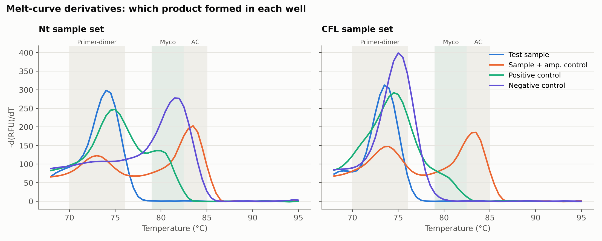
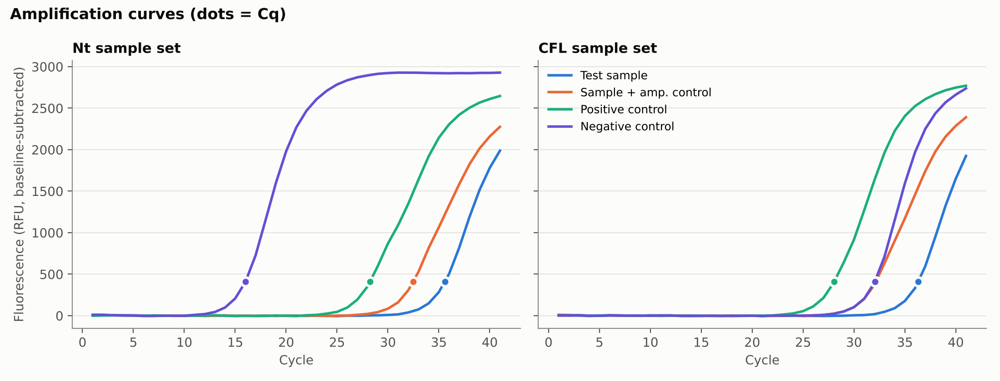
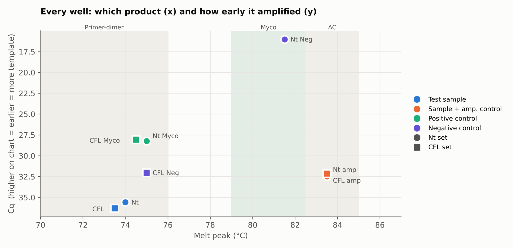

# Mycoplasma Screening of Cell-Culture Samples by qPCR

**Genevieve Morales · UC Berkeley Chemical Engineering · September 2026**

Mycoplasma are tiny, wall-less bacteria that quietly contaminate cell cultures. They don't cloud the media, but they change how cells grow and behave, which can invalidate experiments. I screened two cell-culture samples (**Nt** and **CFL**) with a SYBR Green qPCR assay and wrote a Python pipeline to analyze the run and apply the assay's interpretation rules automatically.



## Key findings

| | Result |
|---|---|
| **Nt sample** | No Mycoplasma product detected; amplification control worked (no inhibition) |
| **CFL sample** | No Mycoplasma product detected; amplification control worked (no inhibition) |
| **Run validity** | **Not valid as a final result.** The Nt negative control was contaminated, and both positive controls were weak |
| **Conclusion** | Both samples are *presumptively negative*. Repeat the run in duplicate before reporting them clean |

## Method

**Wet lab.** DNA was extracted from each culture sample with spin-column purification. For each sample, four reactions were run on a Bio-Rad CFX (SYBR Green, 41 cycles, 65–95 °C melt), using a protocol based on the Agilent MycoSensor QPCR assay:

| Reaction | Contains | What it tells you |
|---|---|---|
| Test sample | Sample DNA | Is Mycoplasma DNA present? |
| Sample + amplification control (AC) | Sample DNA + spiked control template | Is anything in the sample blocking PCR? |
| Positive control | Mycoplasma control DNA | Can the reaction detect Mycoplasma at all? |
| Negative control | Water | Are the reagents contaminated? |

**Why melt curves matter here.** SYBR Green binds *any* double-stranded DNA, so a Cq value by itself doesn't say what was amplified. Each product melts at its own temperature. That temperature is what separates real target from primer-dimer (a short artifact from primers sticking to each other):

| Product | Kit reference Tm | Observed on this instrument |
|---|---|---|
| Primer-dimer | ~74 °C | 73.5–75 °C |
| Mycoplasma target | ~82 °C | ~80 °C (calibrated) |
| Amplification control | ~85 °C | 83.5 °C |

Tm values shift by 1–2 °C between instruments. The pipeline therefore **calibrates on the AC peak** observed in this run (83.5 °C) and expects the Mycoplasma product about 3 °C below it, the same spacing the kit specifies.

**Analysis (`scripts/analyze_qpcr.py`).**
1. Repairs the CFX `.xlsx` exports, which use Windows-style paths inside the file that standard Python readers reject (`scripts/fix_xlsx.py`).
2. Merges Cq, melt-peak, and end-point tables, and labels every well by sample and reaction type.
3. Classifies each well's product from its melt temperature.
4. **Scans the full melt-derivative curve, not just the instrument's reported peak.** The CFX software reports only the tallest peak per well. A small target product sitting next to a big primer-dimer peak would be missed. The script measures the signal inside the Mycoplasma window directly.
5. Applies the kit's decision rules and writes `results/calls.csv` and the figures.

## Results

| Well | Reaction | Cq | Main peak | Signal in Myco window | Call |
|---|---|---|---|---|---|
| A01 | Nt test | 35.6 | 74.0 °C | 1 | No Mycoplasma product |
| A02 | Nt + AC | 32.5 | 83.5 °C | — | AC amplified, no inhibition |
| A03 | Positive control | 28.2 | 75.0 °C | 136 | **Weak**: target shoulder at ~80 °C |
| A04 | Negative control | **16.0** | **81.5 °C** | 266 | **Contaminated** |
| B01 | CFL test | 36.3 | 73.5 °C | 0.4 | No Mycoplasma product |
| B02 | CFL + AC | 32.2 | 83.5 °C | — | AC amplified, no inhibition |
| B03 | Positive control | 28.1 | 74.5 °C | 84 | **Weak**: target shoulder at ~80 °C |
| B04 | Negative control | 32.0 | 75.0 °C | 22 | Pass (primer-dimer only) |





### Interpretation

- **The samples look clean.** Both test wells amplified late (Cq ~36) and produced *only* primer-dimer. Their signal in the Mycoplasma window is essentially zero. Both AC wells produced the 83.5 °C control product, so a late or absent signal isn't caused by PCR inhibition.
- **A late Cq isn't a positive.** The test wells have Cq values (~36) that could be misread as "low-level Mycoplasma." The melt curve shows that the amplified product is primer-dimer. This is the main reason to always pair SYBR Cq values with a melt curve.
- **The Nt negative control was contaminated.** Water should give nothing, or only late primer-dimer. Well A04 amplified at Cq 16 with a product near the Mycoplasma window, about 12 cycles *earlier* than the positive control. If amplification were perfectly efficient, that would mean thousands of times more template. The CFL negative control (B04), presumably set up from the same reagents, was clean. That suggests a well-specific pipetting or aerosol contamination rather than a contaminated master mix.
- **The positive controls were weak.** Both produced a target product, visible as a shoulder at ~80 °C, but primer-dimer dominated. The instrument's peak calling missed the target entirely; the full-curve scan caught it.

Under the kit's rules, a contaminated negative control means the run must be repeated. **The samples are presumptively negative, not confirmed negative.**

## Limitations and next steps

- **Single replicates.** The kit specifies duplicates. Repeat with duplicate wells, fresh water aliquots, and filter tips.
- **Qualitative, not quantitative.** There was no standard curve, so this assay answers *present or absent*. It cannot measure how much Mycoplasma is present.
- **Product identity is inferred from Tm.** Running the products on an agarose gel would confirm their sizes.
- **Primer-dimer.** Strong primer-dimer in the positive controls points to low control-template input or primer excess. Check the template dilution on the repeat run.

## Run it yourself

```bash
pip install -r requirements.txt
python scripts/fix_xlsx.py data/raw data/clean
python scripts/analyze_qpcr.py
```

## Repository layout

```
data/raw/      original Bio-Rad CFX Maestro exports (run 2026-09-11)
data/clean/    repaired copies readable by pandas
scripts/       fix_xlsx.py, analyze_qpcr.py
results/       calls.csv: per-well classification and call
figures/       amplification curves, melt curves, Cq-vs-Tm map
```

*Reference: Agilent Technologies, MycoSensor QPCR Assay Kit Instruction Manual (#302106).*
